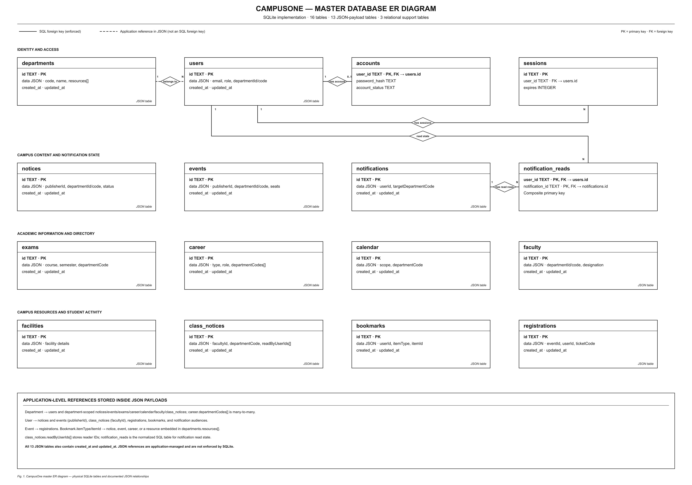
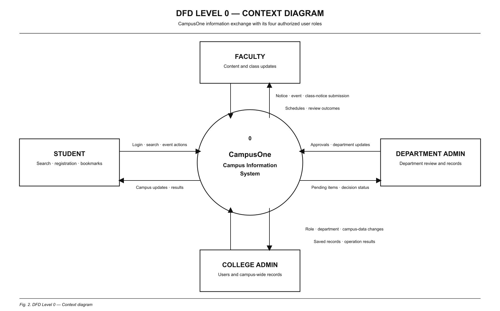
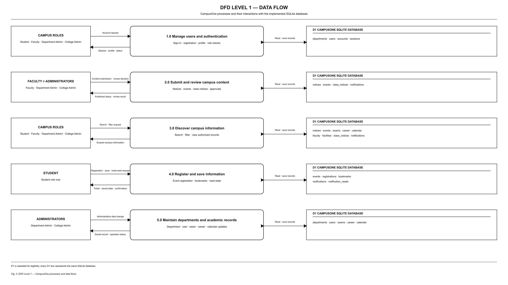
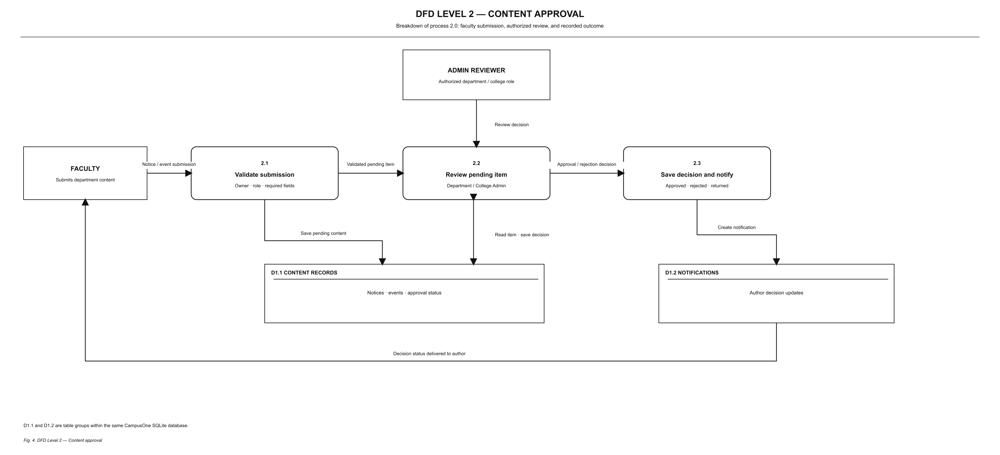
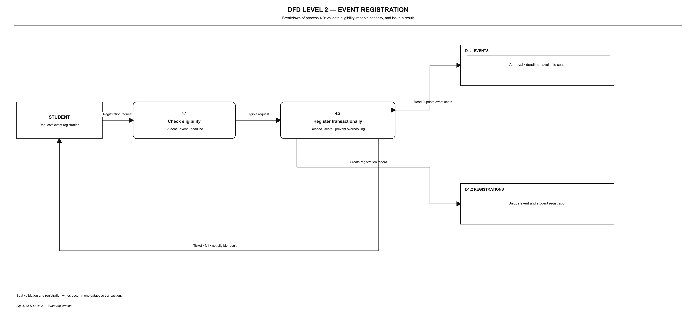

# CampusOne — Project Synopsis

**Candidate:** Tejus Jaiswal  
**Enrollment / Roll No.:** IPS2023-BCA-042  
**Academic Session:** 2026–2027  
**Course:** Bachelor of Computer Applications (BCA), Minor Project  
**Institution:** Institute of Professional Studies, University of Allahabad  
**Department:** Center of Computer Education & Training (CCET)  
**Repository:** https://github.com/tejusjaiswal13-dev/CampusOne

## Purpose
CampusOne brings departmental notices, events, exams and career opportunities into a single role-aware interface. The existing design and example data are retained. The five seed departments are CCET, CFT, CMS, CFDT and CTF; seed people and announcements are demonstration records, not verified institutional information.

## Implemented architecture
React 19, TypeScript 6, Vite 8 and Tailwind CSS 4 provide the interface. Capacitor 8 packages it for Android as a hybrid application using a WebView and native plugins; it is not a React Native application. Express with TypeScript provides the API. SQLite through better-sqlite3 stores persistent data, with bcrypt password hashes in a separate account table. Content tables currently retain typed JSON payloads with indexes; this is not a fully normalized relational schema.

UI, contexts, API access, validation, permissions, database and AI adapters are separated. See docs/ARCHITECTURE.md and docs/ER.md. The backend imports the original seed data instead of maintaining a second hand-written dataset.

## Authentication and authorization
Online sign-in requires email and password. Short-lived signed JWTs use the Authorization header; server-side session records support logout/revocation. The server rechecks active account status and the current database role. Input schemas reject unsupported fields. Login is rate limited.

Students can self-register. Faculty applications remain pending until an authorized administrator approves them. Department and college administrator accounts cannot be self-created. Only the college administrator assigns roles and edits the academic calendar. Department administrators moderate their own department. Faculty submissions require approval. Student feeds include approved college and own-department content. Event registration is student-only and uses a SQLite transaction to prevent last-seat overbooking.

Tokens are stored in sessionStorage for the current client session, not a secure hardware keystore. Production requires HTTPS, a controlled origin allowlist and appropriate device/session hardening. Password reset, email verification and college SSO are future work.

## Modules
The existing home, notices, events, exams, career, calendar, bookmarks, department, profile and role-specific administration screens remain. API-backed changes persist in SQLite. Faculty circulars can be submitted and moderated; bookmarks belong to the authenticated user; notification read state is per user. Some management operations are API-only rather than having dedicated forms. Live attendance is not collected. Timetable views remain clearly labelled sample schedules, with no AI extraction claim.

With VITE_DEMO_MODE enabled, an unreachable backend can activate isolated localStorage demonstration data with a visible badge. This is not an offline synchronization queue: demo changes are never replayed into the backend. Failed online writes are reported rather than silently treated as successful. The evaluator role switcher is confined to demo mode.

## Grounded AI
Authenticated server endpoints support campus questions, editable circular drafts and notice summaries/translation. Provider adapters support OpenAI, Gemini and Claude. API keys remain server-side. Retrieval ranks only eligible records, selects a small context, and checks returned citations against that context. User identity records are not sent to the model. No relevant context results in an explicit unknown answer. Obvious injection patterns are quarantined, but prompt safeguards are not a proof against every adversarial input or hallucination.

The assistant falls back to the existing keyword guide with a visible Basic mode label when the provider is unavailable. Drafts are never automatically published. The user chose mocked-provider verification; no live model quality, latency or billing evaluation has been performed. See AI_DESIGN.md for ten evaluation examples and limitations.

## Android and notifications
Application ID: com.ips.campusone. Backup is disabled. Native sharing and opt-in local notification scheduling are wired. Reminders cover the currently loaded deadline/approval records; they do not provide remote push or guaranteed background refresh. Debug-only cleartext configuration supports a local emulator API. Release configuration should use HTTPS and a private signing keystore outside the repository. See docs/ANDROID.md for exact commands.

## Verification
Each implementation phase ran build, lint and tests before its commit. The test suite covers storage behavior, role/department isolation, approval transitions, faculty application status, token errors, forbidden actions, seat allocation, route guards and mocked AI behavior. See docs/VERIFICATION.md for actual command results and delivery limitations. Tests are not evidence of institutional deployment or exhaustive security certification.

## Limitations and future work
Deploy and monitor the API with TLS, backups and production credentials; configure and evaluate a live AI provider; verify the APK on physical devices; sign and distribute a release; add password recovery/SSO; normalize content relationships further; paginate bootstrap data; implement verified timetable imports and real attendance. Web Push, RFID attendance and measured 2G/3G performance are future work, not implemented achievements. Capacitor remains a hybrid platform.

## Data-quality note
The candidate roll number above is preserved exactly. The seed student Aarav Sharma also uses IPS2023-BCA-042. This is a demo-data clash requiring owner review; it must not be represented as a verified student identity.

## Running and demonstration
Follow README.md for environment setup and demo credentials. Start the API with npm run server and the client with npm run dev in separate terminals. Use docs/DEMO.md for the five-minute role walkthrough and docs/API.md for the endpoint reference.

## System Design Diagrams

The following five figures document the implemented data model and system flows. Figure 1 is the complete master ER view of all 16 implemented SQLite tables. Solid connectors indicate the four physical SQL foreign keys; the relationship register lists the JSON/application references separately. Content attributes shown inside the content-table cards are payload fields, not independent SQL columns.

### Master Entity Relationship Diagram

*Figure 1. Master ER diagram of all implemented tables, their key payload fields, physical foreign keys, and JSON/application references.*

### Data Flow Diagram — Level 0

*Figure 2. System context showing the four CampusOne roles and their information exchange with the system.*

### Data Flow Diagram — Level 1

*Figure 3. Five CampusOne workflows: authentication, content review, information discovery, student participation, and academic-data maintenance.*

### Data Flow Diagram — Level 2: Publishing and Approval

*Figure 4. Faculty content validation, authorized administrator review and decision recording.*

### Data Flow Diagram — Level 2: Event Registration

*Figure 5. Student eligibility checks and event registration with transactional seat handling.*

The ER and DFD figures describe the database and behavior implemented in this project. The SQLite schema does not contain separate approval, subject, semester or timetable tables. Most content relationships are stored in JSON payloads and checked by application logic rather than enforced as SQL foreign keys. The AI provider is optional and was tested with a mocked provider; a live provider has not been configured. It is not part of the core Level 0 context diagram. See [the diagram and notation guide](docs/diagrams/README.md).
