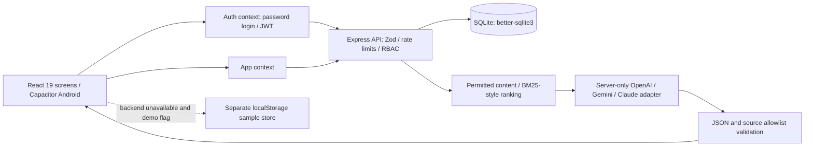

# Architecture

The backend imports the original seedData.ts; no hand-copied seed database is maintained. Authenticated reads filter before returning content. The assistant uses a stricter approved-college/own-department policy and never receives account/registration tables. Event registration changes the seat count and adds the registration in one immediate transaction.

Browser tokens are short-lived and sessionStorage-based (not HttpOnly). Logout revokes the session when reachable; if disconnected, the token remains valid server-side until its short expiry, although the client discards it. No automatic offline-write synchronization exists. UI state is reset on identity/mode changes so online records do not appear in a different demo profile.

Server configuration is loaded from .env. Vite only receives the VITE_ public values. .env, SQLite databases and signing keys are gitignored. Backend TLS termination and production deployment are operator responsibilities.
