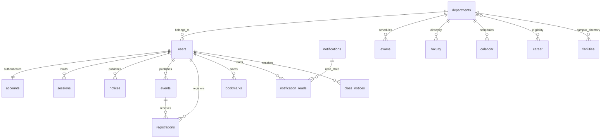

# Entity relationships

This is a logical model. Content tables store id, validated JSON data, created_at and updated_at. `accounts.user_id`, `sessions.user_id` and notification_reads have SQL foreign keys. Email, event/user registration and bookmark identity have unique SQL indexes. Department/user/status fields have JSON-expression indexes. Remaining relationships are application-validated or embedded in existing seed records, not enforced as foreign keys. Career department lists are embedded arrays; facilities are campus-wide rather than physically department-linked. This preserves original data without claiming full normalization.

Tables: departments, users, notices, events, registrations, exams, career, calendar, faculty, facilities, notifications, bookmarks, class_notices, accounts, sessions, notification_reads. Password hashes never appear in user JSON. Schema creation is idempotent; versioned migrations and large-scale full-text search remain future work.
